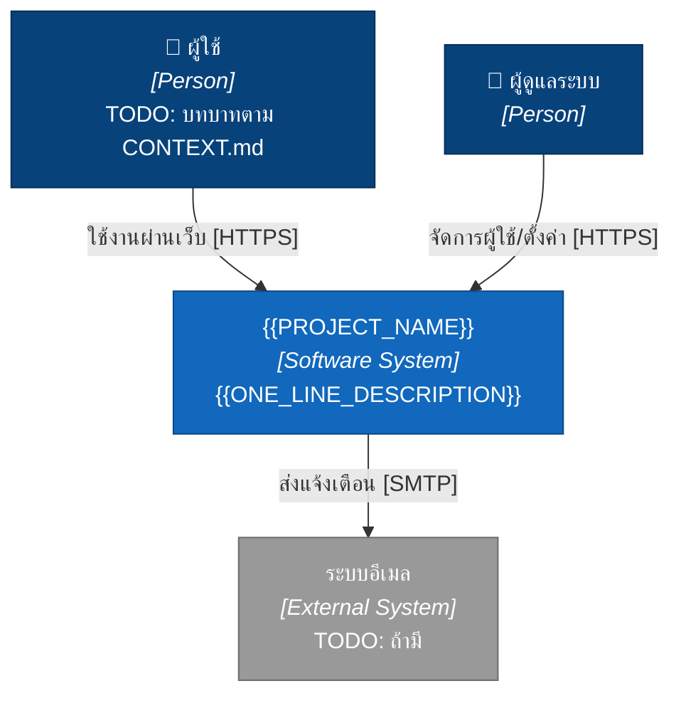
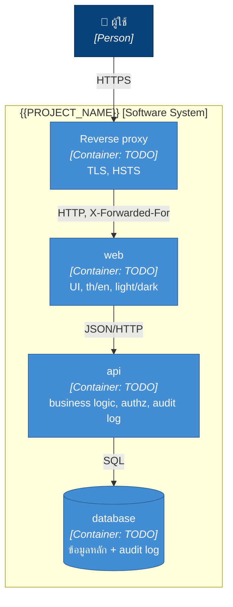
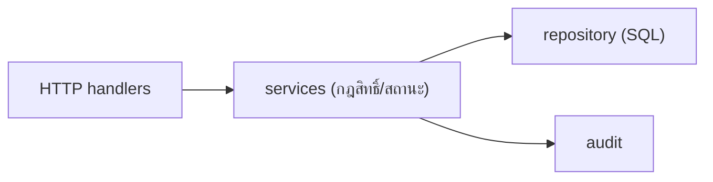

# Architecture — {{PROJECT_NAME}}

> ประเภทเอกสาร: **explanation** (`docs/README.md`) — เติมหลังเลือก stack ใน `docs/adr/0001-stack.md` แล้ว อัปเดตใน PR เดียวกับที่โครงสร้างเปลี่ยน
> รูปตาม [C4 model](https://c4model.com/): ระดับ 1 (Context) และ 2 (Container) ต้องมีเสมอ, ระดับ 3 (Component) เฉพาะ container ที่ซับซ้อน, ไม่ทำระดับ 4 (Code)

## ระดับ 1: System Context

ใครใช้ระบบ และระบบคุยกับระบบภายนอกอะไรบ้าง — คนที่ไม่ใช่นักพัฒนาอ่านรูปนี้แล้วต้องเข้าใจ

## ระดับ 2: Container

แต่ละสิ่งที่ deploy แยกได้ (service ใน compose, DB, volume) และคุยกันด้วยอะไร

| container | เทคโนโลยี | หน้าที่ | อยู่ที่ | health |
|---|---|---|---|---|
| web | TODO | UI | `web/` | `/healthz`, `/readyz` |
| api | TODO | business logic, auth, audit log | `api/` | `/healthz`, `/readyz` |
| db | TODO | เก็บข้อมูล | container / managed | — |

<!-- ระดับ 3 (Component): เพิ่มเมื่อ container ไหนมี module ที่ต้องอธิบายการแบ่งหน้าที่ เช่น
## ระดับ 3: Component — api

-->

## ข้อมูลหลัก (data model)

TODO: ER diagram (`erDiagram` ของ mermaid) ของ entity หลัก ชื่อตาม `CONTEXT.md`

## ข้อมูลส่วนบุคคล (PDPA)

| ข้อมูล | เก็บที่ | ใช้ทำอะไร | เก็บนานเท่าไร |
|---|---|---|---|
| TODO | | | |

## Auth และ session

TODO: วิธี login, บทบาทผู้ใช้, ค่า session timeout ที่ใช้จริง (`.agents/rules/api.md`)

## Audit log

TODO: ตารางที่เก็บ, เหตุการณ์ที่บันทึก, ระยะเก็บ, ใครดูได้ (`.agents/rules/api.md`)

## Backup

RPO / RTO ที่ใช้จริง และที่เก็บนอกเครื่อง (`docs/backup.md`)

## Environments

| env | URL | deploy โดย |
|---|---|---|
| local | http://localhost | `make up` |
| dev | {{DEV_URL}} | agent/CI จาก branch |
| prod | TODO | คนเท่านั้น |
