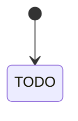
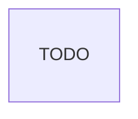

# <ชื่อระบบ / ฟีเจอร์>

<!-- คัดลอกไฟล์นี้เป็น docs/design/<slug>.md ตาม docs/design-process.md
     ห้ามลบหรือเปลี่ยนชื่อหัวข้อ ## 1–15 (make docs-check ตรวจ) — หัวข้อที่ไม่เกี่ยวเขียน "ไม่เกี่ยว — <เหตุผล>"
     ลบ comment นี้และตัวอย่างในวงเล็บเมื่อเขียนจริง -->

## 1. เป้าหมายและผู้ใช้

- ปัญหาที่แก้: TODO
- ผู้ใช้ (บทบาทตาม CONTEXT.md) และจำนวน: TODO
- วัดผลสำเร็จอย่างไร: TODO

## 2. ขอบเขต

| MVP (รอบนี้) | ทีหลัง | ไม่ทำ |
|---|---|---|
| TODO | | |

## 3. User journey

<!-- 1 หัวข้อย่อยต่อบทบาท เป็นขั้นตอนที่ผู้ใช้ทำจริง -->

### TODO: บทบาท

1. TODO

## 4. สิทธิ์ (role × action)

<!-- ทุก action ที่เขียนข้อมูล รวมทางอ้อม (ยกเลิก, รวมรายการ, คืนสถานะ, งานเบื้องหลัง) — ✅ ได้ / ❌ ไม่ได้ / 🔸 ได้เฉพาะของตัวเอง (อธิบายใต้ตาราง) -->

| action | TODO บทบาท 1 | TODO บทบาท 2 | Admin |
|---|---|---|---|
| TODO | | | |

## 5. สถานะและกฎ



| จาก → ไป | ใครทำได้ | เงื่อนไข | ผลข้างเคียง (แจ้งเตือน, audit) |
|---|---|---|---|
| TODO | | | |

## 6. Data model



| ตาราง | ฟิลด์หลัก | unique / บังคับ / index | หมายเหตุ |
|---|---|---|---|
| TODO | | | |

## 7. หน้าจอ (wireframe)

<!-- ทุกหน้าใหม่/ที่แก้: wireframe แบบข้อความ + สถานะ (ว่าง / โหลด / error / ไม่มีสิทธิ์) — ข้อความบนจอเขียนเป็นภาษาไทย (ไฟล์แปลทำตอนเขียนโค้ด) -->

### TODO: ชื่อหน้า (`/path`) — บทบาทที่เข้าได้

```text
┌─────────────────────────────────────────┐
│ หัวข้อหน้า                     [ปุ่มหลัก] │
├─────────────────────────────────────────┤
│ [ค้นหา…]  [ตัวกรอง ▾]                      │
│ ┌───────┬────────────┬─────────┐        │
│ │ คอลัมน์ │ คอลัมน์       │ สถานะ    │        │
│ └───────┴────────────┴─────────┘        │
└─────────────────────────────────────────┘
```

- ว่าง: TODO
- error / ไม่มีสิทธิ์: TODO
- mobile: TODO

## 8. การแจ้งเตือน

| เหตุการณ์ | ใครได้รับ | ช่องทาง | ภาษา |
|---|---|---|---|
| TODO | | | ของผู้รับ |

## 9. ข้อกำหนดที่ไม่ใช่ฟังก์ชัน

| เรื่อง | ค่าที่ตกลง | อ้างอิง |
|---|---|---|
| ขนาดงาน (ผู้ใช้พร้อมกัน, ข้อมูล/เดือน) | TODO | |
| login / SSO | TODO | |
| session (idle / absolute) | 60 นาที / 24 ชม. (ค่าเริ่มต้น) | `.agents/rules/api.md` |
| audit log: เหตุการณ์ใหม่ + ระยะเก็บ | TODO | `.agents/rules/api.md` |
| ภาษา + ปี (พ.ศ./ค.ศ.) | th + en / TODO | `docs/ui.md` |
| theme | system / light / dark | `docs/ui.md` |
| ข้อมูลส่วนบุคคล (อะไร, นานเท่าไร, ใครเห็น) | TODO | PDPA |
| RPO / RTO | 24 ชม. / 4 ชม. (ค่าเริ่มต้น) | `docs/backup.md` |
| ฟีเจอร์ AI | ไม่มี / TODO | `docs/ai-agents.md` |

## 10. Threat model (STRIDE)

<!-- ครบ 6 แถว — ทางเข้าใหม่: route, ฟอร์ม, ไฟล์อัปโหลด, webhook, งานเบื้องหลัง, id ที่รับจากผู้ใช้ -->

| ภัย | ตัวอย่างในงานนี้ | กันอย่างไร | test |
|---|---|---|---|
| **S**poofing (ปลอมตัว) | TODO | | |
| **T**ampering (แก้ข้อมูล/ส่ง id ของคนอื่น) | TODO | | |
| **R**epudiation (ปฏิเสธว่าไม่ได้ทำ) | TODO | audit log | |
| **I**nformation disclosure (ข้อมูลรั่ว) | TODO | | |
| **D**enial of service (ทำให้ใช้ไม่ได้) | TODO | | |
| **E**levation of privilege (ได้สิทธิ์เกิน) | TODO | | |

## 11. เหตุการณ์ขอบที่ตัดสินแล้ว

| เหตุการณ์ | ตัดสินว่า |
|---|---|
| TODO | |

## 12. การย้ายข้อมูล

- migration: TODO (เพิ่มอย่างเดียว / ต้องแปลงข้อมูลเดิม)
- import ข้อมูลเดิม: TODO
- rollback: TODO

## 13. แผนส่งมอบ

<!-- ชิ้นละ 1 issue / 1 PR ที่ merge ได้เอง ใช้งานได้ end-to-end — ชิ้นแรกเล็กที่สุด; ขนาดตาม docs/design-process.md หัวข้อ 4
     ชิ้นงาน: ระบุตาราง (migration), route/หน้าจอ, dependency ใหม่ ที่ชิ้นนั้นส่ง — e2e อยู่ในทุกชิ้น ไม่แยกเป็นชิ้นท้าย -->

| # | ชิ้นงาน | ขึ้นกับ | issue |
|---|---|---|---|
| 1 | TODO | — | |

## 14. คำถามที่ยังเปิด

<!-- "- [ ] คำถาม — ใครตัดสิน, ภายในเมื่อไร" — design ที่ approved ต้องไม่มี "- [ ]" -->

- [ ] TODO

## 15. Stack และ environment

<!-- type: system — สรุปจาก ADR-0001 + repo, dev URL, เครื่อง production, งบทรัพยากรต่อ service, ข้อมูล seed; type: feature — "ไม่เกี่ยว" หรือ service/งบที่เพิ่ม -->

TODO
